# MPSL

**Fine-Tuning Multimodal Transformers on Edge: A Parallel Split Learning Approach**

Timo Fudala · Vasileios Tsouvalas · Nirvana Meratnia

[ Paper](https://arxiv.org/abs/2502.06355) · [ Project](https://nousphera.github.io/MPSL/) · [Datasets](DATASETS.md) · [Experiments](docs/experiments.md) · [Method](docs/REPRODUCIBILITY.md)

## Abstract

Multimodal transformers are expensive to fine-tune on resource-constrained edge
devices. MPSL distributes this work between lightweight client tokenizers and a
shared server encoder. Clients tokenize images, audio and text, while the server
processes their representations and supports early or late modality fusion.
Client objectives are combined into a sample-weighted update with one server
backward pass. The framework supports visual question answering, sentiment and
emotion recognition, action recognition, and image–text retrieval, with
centralized and federated baselines. See the [paper](https://arxiv.org/abs/2502.06355)
for the method and reported experiments.

**Implementation:** a single-process simulator with explicit client/server
tensor exchanges, early and late fusion, and classification and retrieval
trainers. The [protocol guide](docs/REPRODUCIBILITY.md#explicit-gradient-exchange)
describes gradient exchange, communication accounting and privacy properties.

<p align="center">
  <a href="https://nousphera.github.io/MPSL/#findings">
    <picture>
      <source media="(prefers-color-scheme: dark)" srcset="docs/assets/readme/results-dark.svg">
      
    </picture>
  </a>
</p>

*Client compute savings and task-level accuracy, shown together.* [Interactive explanation](https://nousphera.github.io/MPSL/#overview).

## Requirements

Use **Python 3.11 or 3.12** on macOS or Linux. The CPU environment uses
PyTorch 2.14.1, torchvision 0.29.1, torchaudio 2.11.0, Transformers 5.19 and
OpenCLIP 3.3. Install Python's `venv` support (`python3.11-venv` on distributions
that package it separately). Media decoding uses PyAV wheels; no system FFmpeg
command is required on the tested macOS wheel installation.

```bash
git clone https://github.com/Nousphera/MPSL.git
cd MPSL
bash scripts/setup.sh
source .venv/bin/activate
python -m pytest
```

The setup script creates an isolated environment and installs all experiment and
test dependencies. Set `PYTHON_BIN=python3.12` or `VENV_DIR=/path/to/venv` to change
them. On Linux it explicitly selects the CPU PyTorch/vision/audio wheels together.
For CUDA, create a separate environment, install compatible wheels from the
[PyTorch installer](https://pytorch.org/get-started/locally/), then run
`python -m pip install -e '.[experiments,test]'`. Select matching PyTorch, torchvision and torchaudio wheel variants.

For a smaller trainer-only environment, use
`SETUP_PROFILE=smoke bash scripts/setup.sh`. Optional media/model integration tests
will be skipped when those dependencies are absent. The
[resolved macOS Python 3.11 environment](requirements-tested-macos-py311.txt)
records the tested full installation; it is a platform-specific snapshot.

## Datasets

All seven paper datasets have a source importer and use the same prepared
manifest interface in the actual training loaders. Follow [DATASETS.md](DATASETS.md)
for provider access, exact extracted layouts and commands for COCO-QA, B-T4SA,
COCO retrieval, Flickr30K, UCF101's audio subset, Kinetics-Sounds and MELD.

```bash
python scripts/prepare_data.py --dataset coco-qa --source /data/raw --root data
python scripts/prepare_data.py --dataset coco-qa --root data --validate
```

Preparation references original files in place and records splits, labels,
annotation hashes and media sizes. `--hash-media` adds content hashes;
`--check-media` fully decodes audio/video. Keep the source files available.
Restricted or large datasets must be acquired explicitly from their providers.
No constructor downloads, renames or deletes them.

## Training

First exercise both fusion paths without datasets or checkpoints:

```bash
python -m mpsl.smoke --output runs/smoke
```

This trains two clients with two synthetic modalities through the real
classification split trainer. Use a new output directory for another run.

For research training, obtain the **Meta-Transformer base encoder** from its
[model zoo](https://github.com/invictus717/MetaTransformer#-model-zoo) and save it as
`checkpoints/Meta-Transformer_base_patch16_encoder.pth`. The
[experiment guide](docs/experiments.md) lists tokenizer checkpoints, cache paths,
audio options and baseline commands. Then run on prepared data:

```bash
mkdir -p cache/preprocessors cache/tokenizers checkpoints
python -m mpsl.main_mpsl \
  --dataset coco-qa --dataset_split_type noniid --dirichlet_alpha 0.1 \
  --nr_of_clients 25 --batch_size 125 --nr_of_epochs 15 \
  --nr_of_last_encoder_blocks_to_finetune 6 --start_lr 1e-4 \
  --random_seed 2024 --save_file_name cocoqa-mpsl \
  --torch_data_dir data --pre_processors_cache_dir cache/preprocessors \
  --tokenizer_weights_cache_dir cache/tokenizers --model_weights_dir checkpoints
```

The server batch size must be divisible by the client count, with enough examples
for each client. The paper's Dirichlet concentration is `0.1`; adjust `--dirichlet_alpha` to study other client distributions. `python -m mpsl.main_mpsl --help`,
`python -m mpsl.main_centralized --help` and `python -m mpsl.main_fl --help` expose
all options. Full pretrained experiments need substantially more memory and time
than the CPU check; the original experiments used an NVIDIA H100.

## Pretrained models

MPSL uses the [Meta-Transformer base encoder](https://github.com/invictus717/MetaTransformer#-model-zoo)
with modality-specific tokenizers: OpenCLIP for vision/text and AST for audio.
The [checkpoint guide](docs/experiments.md#checkpoints-and-caches) lists exact
model identifiers, local filenames and cache settings. Acquire the encoder
before training; tokenizers load on first use or from a populated cache.

## Evaluation

Each training epoch evaluates the aggregated client tokenizer and shared server
encoder on the prepared test split. Classification reports example-weighted loss
and accuracy; retrieval reports recall in both image-to-text and text-to-image
directions. Inspect the run in the training example with:

```bash
python -m json.tool checkpoints/cocoqa-mpsl.json
```

Use the same source manifest, label map and client partitions across comparisons.
The [protocol guide](docs/REPRODUCIBILITY.md) defines the prediction-gradient
exchange and exactly which tensor bytes enter communication counts.

## Outputs and configuration

The smoke writes `runs/smoke/metrics.json`, including losses, accuracy, payload
bytes and client indices. Research runs write `<save_file_name>.json` and
`<save_file_name>.pth` under `--model_weights_dir`. JSON includes configuration,
prepared-manifest hash, class map, split counts, metric history and communication
counters. Use a unique save name to preserve earlier results.

Tests cover source-format preparation for all seven datasets, unchanged raw files,
actual classification/retrieval split-training updates, deterministic media
evaluation, gradient equivalence across serialized tensor boundaries, partition
coverage and checkpoint round trips. Tensor byte counts include prediction-gradient uploads and exclude serialization
and network framing. See the [protocol guide](docs/REPRODUCIBILITY.md) for the
message sequence and [dataset guide](DATASETS.md) for label maps and audio shapes.

## Results

**Published classification results:** Meta-Transformer ViT-B/16, 100 clients,
Dirichlet concentration 0.1 and three seeds. Selected tasks from
[Table 1](https://arxiv.org/pdf/2502.06355v3#page=5); accuracy is in percent and
GFLOPs refer to average client computation. The table preserves the paper's ± values.

| Method | COCO-QA (%) | Kinetics-Sounds (%) | MELD (%) | Client GFLOPs |
| --- | --- | --- | --- | --- |
| Centralized | 61.7 ± 0.1 | 81.8 ± 0.2 | 61.4 ± 0.4 | 25.8 |
| FedAvg | 53.5 ± 0.2 | 71.4 ± 0.4 | 48.9 ± 0.0 | 25.8 |
| FedCLIP | 13.1 ± 2.6 | 63.5 ± 0.8 | 50.7 ± 0.7 | 25.8 |
| **MPSL** | 46.2 ± 0.5 | 67.0 ± 1.1 | 58.2 ± 0.9 | 0.1 |

MPSL reduces client computation and improves MELD relative to FedAvg; the
COCO-QA and Kinetics-Sounds columns show the accompanying accuracy trade-offs.
[Classification and retrieval results](https://nousphera.github.io/MPSL/#findings).

## Citation

```bibtex
@misc{fudala2025finetuningmultimodaltransformersedge,
  title={Fine-tuning Multimodal Transformers on Edge: A Parallel Split Learning Approach},
  author={Timo Fudala and Vasileios Tsouvalas and Nirvana Meratnia},
  year={2025},
  eprint={2502.06355},
  archivePrefix={arXiv},
  primaryClass={cs.DC},
  url={https://arxiv.org/abs/2502.06355}
}
```

## License

[MIT](LICENSE). Dataset, pretrained model and third-party code terms apply
separately; those resources are not redistributed by this repository.
