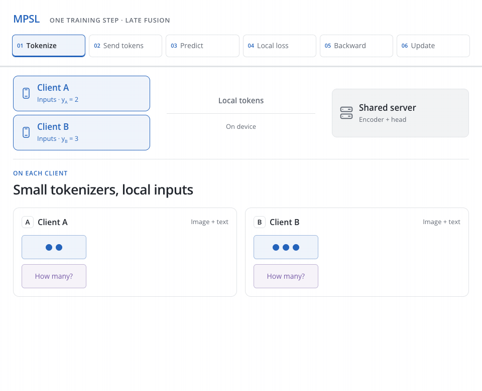

<h1 align="center">MPSL</h1>
<p align="center"><strong>Fine-Tuning Multimodal Transformers on Edge:<br>A Parallel Split Learning Approach</strong></p>
<p align="center">Timo Fudala · <a href="https://vtsouval.github.io/"><strong>Vasileios Tsouvalas</strong></a> · Nirvana Meratnia</p>

<p align="center">
  <a href="https://arxiv.org/abs/2502.06355" title="Paper"><picture><source media="(prefers-color-scheme: dark)" srcset="docs/assets/icons/paper-dark.svg"></picture></a>
  &nbsp; · &nbsp;
  <a href="https://nousphera.github.io/MPSL/" title="Project"><picture><source media="(prefers-color-scheme: dark)" srcset="docs/assets/icons/project-dark.svg"></picture></a>
  &nbsp; · &nbsp;
  <a href="https://nousphera.github.io/assets/posters/mpsl-a0-landscape.pdf" title="Poster"><picture><source media="(prefers-color-scheme: dark)" srcset="docs/assets/icons/poster-dark.svg"></picture></a>
</p>

## Abstract

**Multimodal Parallel Split Learning (MPSL)** moves transformer fine-tuning from resource-constrained clients to a shared server. Clients retain lightweight modality tokenizers and send representations for **parallel server processing**. Local objectives drive a **single, sample-weighted server update**, with gradients returned to clients. MPSL supports early and late fusion across vision, language and audio, covering question answering, sentiment and emotion recognition, action recognition, and image–text retrieval. It substantially reduces client computation, with task-dependent accuracy trade-offs.

<p align="center">
  <a href="docs/assets/readme/method-light.mp4" title="Watch the method video">
    <picture>
      <source media="(max-width: 600px) and (prefers-color-scheme: dark)" srcset="docs/assets/readme/method-dark-mobile.gif">
      <source media="(max-width: 600px)" srcset="docs/assets/readme/method-light-mobile.gif">
      <source media="(prefers-color-scheme: dark)" srcset="docs/assets/readme/method-dark.gif">
      
    </picture>
  </a>
</p>

## Setup

**Python 3.11 or 3.12** · macOS or Linux

```bash
git clone https://github.com/Nousphera/MPSL.git
cd MPSL
bash scripts/setup.sh
source .venv/bin/activate
```

Creates `.venv` and installs **[requirements.txt](requirements.txt)**. [Manual and CUDA setup →](docs/experiments.md#installation)

## Data and weights

Acquire the source data using the **[dataset guide](DATASETS.md)**, then prepare and validate it:

```bash
python scripts/prepare_data.py --dataset coco-qa --source /data/raw --root data
python scripts/prepare_data.py --dataset coco-qa --root data --validate
mkdir -p checkpoints
```

Keep the source files in place. Download the **[Meta-Transformer base encoder](https://github.com/invictus717/MetaTransformer#-model-zoo)** to `checkpoints/Meta-Transformer_base_patch16_encoder.pth`. [Tokenizer weights and caches →](docs/experiments.md#checkpoints-and-caches)

## Train and evaluate

```bash
python -m mpsl.main_mpsl \
  --dataset coco-qa --dataset_split_type noniid --dirichlet_alpha 0.1 \
  --nr_of_clients 100 --batch_size 500 --nr_of_epochs 15 \
  --nr_of_last_encoder_blocks_to_finetune 6 \
  --num_workers 0 --test_num_workers 0 \
  --save_file_name cocoqa-mpsl
```

Each epoch evaluates on the test split. Metrics and weights are saved to `checkpoints/cocoqa-mpsl.{json,pth}`. Use a distinct save name per run. The server batch size must be divisible by the client count.

**[Baselines and configuration →](docs/experiments.md#training-and-baselines)** · **[Published results →](https://nousphera.github.io/MPSL/#findings)**

## Citation

```bibtex
@misc{fudala2025finetuningmultimodaltransformersedge,
  title={Fine-tuning Multimodal Transformers on Edge: A Parallel Split Learning Approach},
  author={Timo Fudala and Vasileios Tsouvalas and Nirvana Meratnia},
  year={2025},
  eprint={2502.06355},
  archivePrefix={arXiv},
  primaryClass={cs.DC},
  url={https://arxiv.org/abs/2502.06355}
}
```

[MIT License](LICENSE)
